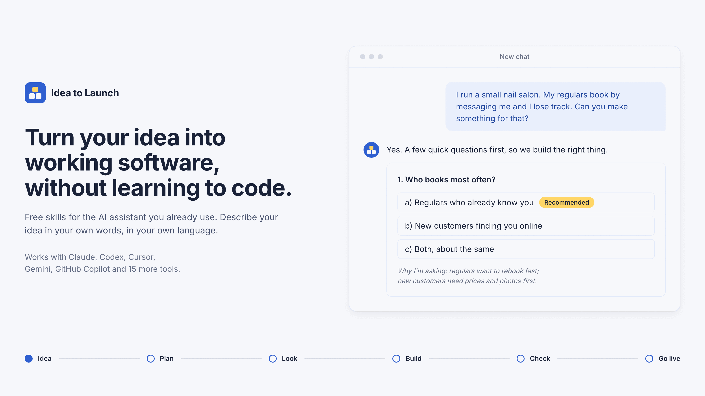
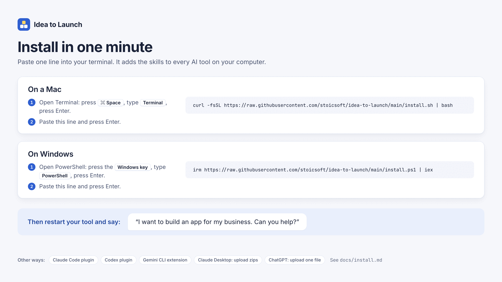
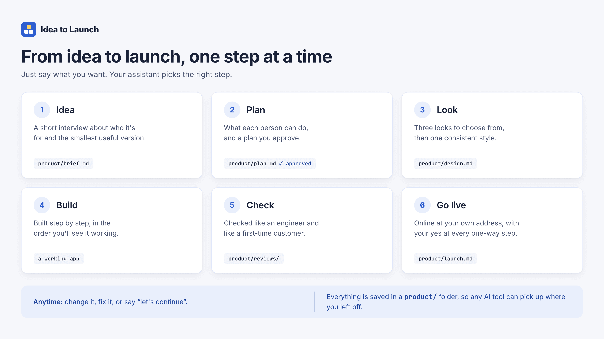
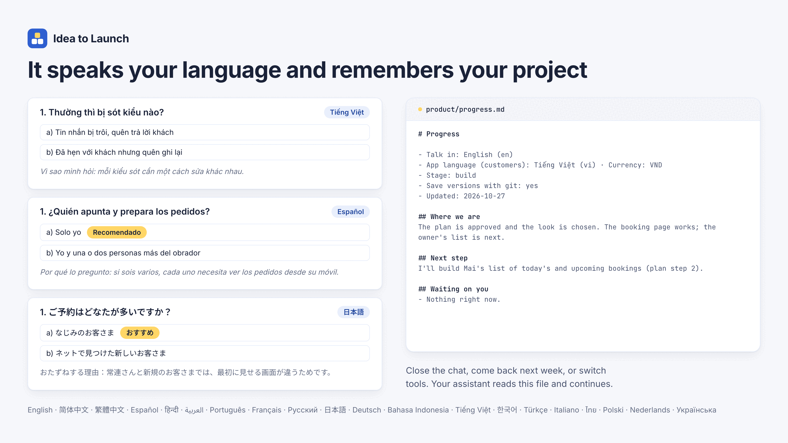

# Idea to Launch

**Turn your idea into working software, without learning to code.**



Idea to Launch is a free set of skills for the AI assistant you already
use: Claude, Codex, Cursor, Gemini, GitHub Copilot and
[15 more tools](docs/install.md#every-supported-tool). Describe your idea in
your own words, in your own language. Your assistant asks you a few good
questions, writes a one-page plan for you to approve, builds it, checks it
like a real customer would, and helps you put it on the internet.

**Languages:** English · [简体中文](docs/i18n/README.zh-CN.md) · [繁體中文](docs/i18n/README.zh-TW.md) · [Español](docs/i18n/README.es.md) · [हिन्दी](docs/i18n/README.hi.md) · [العربية](docs/i18n/README.ar.md) · [Português](docs/i18n/README.pt-BR.md) · [Français](docs/i18n/README.fr.md) · [Русский](docs/i18n/README.ru.md) · [日本語](docs/i18n/README.ja.md) · [Deutsch](docs/i18n/README.de.md) · [Bahasa Indonesia](docs/i18n/README.id.md) · [Tiếng Việt](docs/i18n/README.vi.md) · [한국어](docs/i18n/README.ko.md) · [Türkçe](docs/i18n/README.tr.md) · [Italiano](docs/i18n/README.it.md) · [ไทย](docs/i18n/README.th.md) · [Polski](docs/i18n/README.pl.md) · [Nederlands](docs/i18n/README.nl.md) · [Українська](docs/i18n/README.uk.md)

## What it feels like

> **You:** I run a small nail salon. My regulars book by messaging me and I
> lose track. Can you make something for that?
>
> **Assistant:** Yes. A few quick questions first, so we build the right
> thing. **1. Who books most often?** a) Regulars who already know you
> (recommended) · b) New customers finding you online · …

A few rounds later, you have:
- **a one-page brief** of your idea, in your words: "A booking page where
  Mai's regulars pick a free time without messaging her";
- **a plan you approve** before anything is built;
- **a look you chose** from three options;
- **a working app** you can open and try, with believable sample content,
  in your customers' language;
- **an honest check** from the point of view of a senior engineer and a
  first-time customer on a phone;
- **step-by-step help to go live** on your own address, and nothing goes
  online, costs money or touches real customers without your clear "yes".

## Install



Copy one line into your computer's terminal. It finds the AI tools on your
computer (Claude Code, Codex, Cursor, Gemini CLI, Copilot and
[15 more](docs/install.md#every-supported-tool)) and adds the skills to all
of them. It only copies text files, needs no admin rights, and you can
remove it at any time.

**On a Mac** (or Linux): open **Terminal** (press ⌘ Space, type
`Terminal`, press Enter), paste this line and press Enter:

```sh
curl -fsSL https://raw.githubusercontent.com/stoicsoft/idea-to-launch/main/install.sh | bash
```

**On Windows:** open **PowerShell** (press the Windows key, type
`PowerShell`, press Enter), paste this line and press Enter:

```powershell
irm https://raw.githubusercontent.com/stoicsoft/idea-to-launch/main/install.ps1 | iex
```

Then **restart your AI tool** (or start a new chat) and say:

> I want to build an app for my business. Can you help?

If you already use Node.js, `npx github:stoicsoft/idea-to-launch` does the
same thing.

### Other ways to install

| Your tool | How to install |
|---|---|
| **Claude Code**, as a plugin | `/plugin marketplace add stoicsoft/idea-to-launch`, then `/plugin install idea-to-launch@idea-to-launch` |
| **Codex** (app or CLI), as a plugin | `codex plugin marketplace add stoicsoft/idea-to-launch`, then `codex plugin add idea-to-launch@idea-to-launch` |
| **Gemini CLI**, as an extension | `gemini extensions install https://github.com/stoicsoft/idea-to-launch` |
| **Claude Desktop** (chat) or claude.ai | The command above can't reach these. Download the zips from [Releases](https://github.com/stoicsoft/idea-to-launch/releases), then **Settings → Capabilities → Skills → Upload skill** for each one ([details](docs/install.md#claude-desktop-and-claudeai)) |
| **ChatGPT or any other chat assistant** | Upload [`idea-to-launch-prompt.md`](docs/install.md#chatgpt-and-other-chat-assistants) to a project or custom GPT |

The full guide, with every tool, how to choose which tools get the skills,
and how to update or remove them, is in [docs/install.md](docs/install.md).

## The steps



You never have to call these by name. Just say what you want, and the
assistant picks the right step. If you prefer, you can call a step
directly, for example `/app-idea` in Claude Code or Cursor.

| Step | What happens | Say something like |
|---|---|---|
| **app-builder** | Start here. Works out what you need, and picks up where you left off | "Help me build an app" · "Let's continue" |
| **app-idea** | A short interview about who it's for and the smallest useful version, saved as a one-page brief | "I have an idea for…" |
| **app-plan** | What each person will be able to do, a one-page spec, and a plan you approve | "What's the plan?" |
| **app-design** | Three looks to choose from, then one consistent style | "How should it look?" |
| **app-build** | Builds it step by step, in the order you'll see it working | "Build it" · "Add a booking page" |
| **app-change** | Small changes in one message, or "this isn't what I wanted" turned into a fix list | "Make the button green" |
| **app-fix** | Finds the real cause of a problem and fixes only that | "It shows an error when I…" |
| **app-review** | Checks it like an engineer and like a first-time customer | "Is it ready for customers?" |
| **app-launch** | Puts it online safely, with your approval at every one-way step | "Put it online" |

## Your project remembers



Everything important is saved as simple pages in a `product/` folder inside
your project: the brief, the plan, the look, decisions, check results and
the next step. Close the chat, come back next week, or switch from Claude to
Codex, and your assistant continues where you left off. In chat-only apps
it gives you these pages to keep instead.

## Your language

- The assistant **talks to you in your language**: whatever you write in.
- The app speaks **your customers' language**, which can be different, or
  several languages at once.
- Code stays in English, so any developer can take over later.

It's tested in 20 languages: English, 简体中文, 繁體中文, Español, हिन्दी,
العربية, Português, Français, Русский, 日本語, Deutsch, Bahasa Indonesia,
Tiếng Việt, 한국어, Türkçe, Italiano, ไทย, Polski, Nederlands and
Українська. Others usually work too.

## Promises it keeps

- **Plain words.** No jargon. Technical words are explained once, the
  first time they're needed.
- **You decide what matters.** Anything hard to undo (deleting data, who
  can see what, payments, emails to customers, going online) always waits
  for your explicit answer. Small, reversible things are decided for you, so
  you aren't buried in questions.
- **Honest results.** It only says something works after actually trying
  it, and it tells you what it couldn't check.
- **Safe with your customers' data.** Private by default, changes that
  never delete saved information, and secrets kept out of the code.
- **Yours.** Standard, readable code and plain-text notes. No lock-in, no
  account, no tracking.

## Good to know

- Building a real app needs a tool that can work with files on your
  computer: Claude Code (or the Code tab in Claude Desktop), Codex, Cursor,
  Gemini CLI, Copilot and similar. Chat-only apps can do the planning and a
  clickable prototype.
- Your AI tool's normal plan and usage limits apply. Hosting and a domain
  name usually cost a few dollars a month once you go live. The assistant
  tells you before anything costs money.
- It's a careful assistant, not a lawyer or an accountant. For payments,
  health data or anything regulated, it will say when you need a
  professional.

## Learn more

- [Install on every tool](docs/install.md)
- [How it works](docs/how-it-works.md)
- [Questions and answers](docs/faq.md)
- [Contributing](CONTRIBUTING.md): improve the skills, add a tool, or translate

## License

[MIT](LICENSE). Free to use, change and share.
